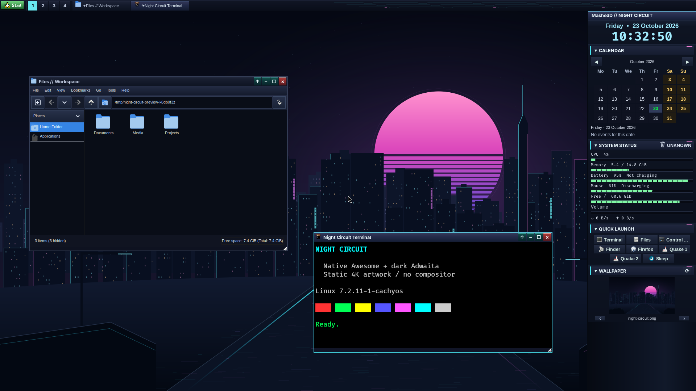

# Desktop themes: Win98 / Aero and Night Circuit

Open **Control Panel → Appearance → Desktop theme**, choose a profile, and click
**Apply**:

- **Win98 / Aero** — the original shared palette and glass gradients,
  centered beveled sidebar headers, continuous meters, regular readouts, and light
  Adwaita GTK without the cyberpunk overlay. This is the default for new profiles.
- **Night Circuit (cyberpunk)** — ink/ultraviolet surfaces, cyan selected desktop,
  static panel circuitry, pink sidebar accents, segmented mint meters, monospace
  readouts, and matching dark Adwaita/GTK4 styling.

Apply saves the selection and requests an Awesome restart **only when switching
profiles**. Fonts, icons, cursor and other advanced GTK options remain editable;
choosing a preset supplies its GTK theme and animation defaults. Reopen applications
(including Control Panel) to reload GTK CSS. Changing ordinary GTK options without
changing the desktop profile does not restart Awesome.

Each profile remembers its own wallpaper. On a first switch, Night Circuit uses
its bundled skyline and Aero uses the cabin fallback; subsequent switches restore
that profile's last selected wallpaper. The current installation's pre-preview
wallpaper was seeded as Aero's initial choice. Sidebar order, folded sections,
visibility, launcher entries, shortcuts and window behavior are not reset.

## Night Circuit preview



Captured in a private Xvfb session with temporary demo folders; no live windows
were moved and no personal documents appear in it. Both profiles retain square
geometry, the full native-size Tux Start asset, Segoe UI titlebars, Microsoft Sans
Serif controls, blue GTK selection, Breeze icons, Adwaita cursors and VAX terminals.
No compositor, extra service or animation is required by Night Circuit.

## Files and persistence

- `dotfiles/.config/awesome/appearance.lua` safely selects a bundled profile from
  `themes/aero.lua` or `themes/night-circuit.lua`; no mutable Lua is executed.
- `$XDG_STATE_HOME/awesome/theme` stores `aero` or `night-circuit` (default: `aero`).
- `$XDG_STATE_HOME/awesome/theme-wallpapers.json` remembers per-profile wallpapers.
- `$XDG_STATE_HOME/awesome/wallpaper` remains the active wallpaper source for both
  Awesome and the lock helper.
- `dotfiles/.local/share/desktop-themes/night-circuit/` contains optional GTK CSS.
  Control Panel adds/removes only its marked import in the local GTK3/GTK4
  `gtk.css`, preserving custom CSS outside the block. Theme selection does not
  delete user styles or remove the bundled assets.
- GTK `settings.ini` files remain local preferences. xsettingsd configuration is
  updated through its existing Stow link. Available GNOME/GSettings dark, GTK-theme
  and animation hints are synchronized without starting another bus or daemon.

Applying a profile validates its assets and rolls back the previous configuration,
CSS, selection, wallpaper/history and desktop preferences on failure. Awesome is
not restarted until application succeeds. The Python profile backend has injectable
service operations so unit/UI tests never alter live services or preferences.

Web content, application-specific browser themes and Qt themes are not overridden.
Switching back to Aero removes the Night Circuit CSS import as well as selecting
light Adwaita; simply changing the separate GTK theme dropdown is not a full
profile switch.

## Original wallpaper and validation

`night-circuit.png` is original 3840×2160 artwork generated deterministically
without fonts, external images, SVG filters, or network requests. To regenerate
(requires `rsvg-convert` from librsvg):

```sh
python3 tools/generate-night-city.py /tmp/night-circuit.svg
rsvg-convert -o dotfiles/.local/share/wallpapers/night-circuit.png /tmp/night-circuit.svg
./tests/run.sh
AWESOME_TEST_THEME=aero python3 tests/test-awesome-session.py --scenario titlebars
AWESOME_TEST_THEME=night-circuit python3 tests/test-awesome-session.py --scenario titlebars
```

Tests cover both palettes' contrast, safe Lua selection, profile round trips,
per-profile wallpapers, preservation of custom CSS/Stow links/GTK preferences,
missing assets, transactional rollback, and the real GTK theme-selector UI on Xvfb.
The initial manual-preview backup remains under
`~/.local/state/desktop-appearance/backups/20261023-100948/`; normal switching no
longer requires restoring backup files.
